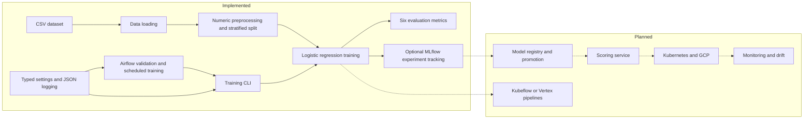

# Credit Scoring

An open-source credit-risk ML platform for reproducible baseline training,
evaluation, experiment tracking, and scheduled validation and retraining.
Model registry promotion, online scoring, cloud deployment, and drift monitoring
are planned in the [roadmap](ROADMAP.md). The [architecture records](docs/adr/README.md)
explain current package, tooling, and orchestration decisions.

## Architecture

Solid connections show implemented workflows. Dashed connections show planned
extensions; the planned group contains no running platform components.



## Development setup

Install Python 3.14, [uv](https://docs.astral.sh/uv/), and
[just](https://github.com/casey/just). `.python-version` selects Python 3.14;
`uv.lock` records dependencies, including development tools. The default groups
are dev and modeling; Airflow is not required for the shared gate.

```bash
uv sync --locked
uv run prek install
just check
```

`just check` runs locked Ruff formatting checks, Ruff lint, mypy, and pytest in
order and stops on failure. The Windows recipe uses PowerShell; Linux uses the
standard just shell. CI runs this same gate on pushes and pull requests.
Mypy covers the entire application package, including legacy wrappers, using
pandas stubs and a scoped missing-import exception for scikit-learn. Tests and
standalone DAGs remain outside the initial type-check target.

Tests run offline with synthetic fixtures, Airflow stubs, and mocked tracking and
subprocess boundaries. No cloud credentials, containers, clusters, or running
external services are required. See [CLAUDE.md](CLAUDE.md) for contributor rules.

```bash
uv run pytest
uv run --locked mypy
uv run prek run --all-files
uv run --locked prek run --all-files --hook-stage pre-push
```

Prek runs whitespace/configuration checks and Ruff fixes/formatting before commits
and tests before pushes. Notebook dependencies are optional:

```bash
uv sync --locked --group notebook
```

## Package structure

| Path | Responsibility |
| --- | --- |
| `src/credit_scoring/data/` | CSV loading and repository-relative default path |
| `src/credit_scoring/features/` | Target selection, stratified splitting, numeric preprocessing |
| `src/credit_scoring/training/` | Logistic regression, CLI coordination, optional tracking |
| `src/credit_scoring/evaluation/` | Accuracy, precision, recall, F1, ROC AUC, average precision (`pr_auc`) |
| `src/credit_scoring/config/` | Typed environment settings |
| `src/credit_scoring/logging.py` | Standard-library JSON application logging |
| `src/credit_scoring/modeling/` | Thin compatibility re-exports and legacy entry point |
| `dags/` | Scheduled Airflow workflows |
| `tests/` | Tests mirroring package ownership and offline DAG tests |

The `train-model` script targets `credit_scoring.training.main:main`. Existing
`credit_scoring.modeling` imports and `python -m credit_scoring.modeling.main`
continue to delegate to the focused packages.

## Training

The supplied default dataset is `data/raw/UCI_Credit_Card.csv`. Training drops
`ID`, uses a stratified split, imputes numeric features with medians, scales them,
and fits baseline logistic regression. Existing tests preserve the split,
preprocessing, model parameters, and six metrics.

```bash
uv run --locked train-model --max-iter 300
uv run --locked train-model --help
uv run --locked python -m credit_scoring.training.main --help
```

## Optional MLflow

Tracking records iterations, evaluation metrics, and the model artifact. It does
not implement registry registration or promotion. Local file tracking works with
MLflow from the default modeling group:

```bash
uv run --locked train-model --max-iter 300 --enable-mlflow --mlflow-experiment credit-scoring
uv run --locked mlflow ui
```

The UI defaults to http://127.0.0.1:5000. To use the existing Compose tracking server:

```bash
podman compose up -d mlflow
uv run --locked train-model --max-iter 300 --enable-mlflow --mlflow-tracking-uri http://127.0.0.1:5000 --mlflow-experiment credit-scoring --mlflow-run-name baseline-lr
```

Compose persists tracking data in `mlflow_data`. Its existing MLflow image uses a
floating tag; the local stack is not a locked production deployment.

## Optional Airflow

The [Compose file](docker-compose.yml) supplies Postgres, initialization, webserver,
and scheduler services. Use rootless Podman with `podman-compose` installed as the
primary local engine; Docker Compose is compatible with the same file (replace
`podman compose` with `docker compose` in these commands).

Copy [.env.example](.env.example) to `.env` and set your own
`AIRFLOW_ADMIN_PASSWORD` before starting. For a POSIX shell:

```bash
cp .env.example .env
podman compose up -d postgres airflow-init airflow-webserver airflow-scheduler
```

Open http://127.0.0.1:8080 and log in as `admin` with that password. Enable and
trigger the desired DAG:

| DAG ID | Schedule | Tasks |
| --- | --- | --- |
| `credit_scoring_data_quality` | Daily | Require `ID`, `LIMIT_BAL`, `AGE`, `default.payment.next.month`; validate overall missing ratio |
| `credit_scoring_training` | Daily | Validate dataset existence, then train (default 300 iterations) |
| `credit_scoring_retraining` | Weekly | Validate dataset existence, then retrain (default 500 iterations) |

Workers need access to source, dependencies, and data. Compose mounts `src/`,
`dags/`, and `data/`; a separate Airflow installation needs equivalent access.
Training subprocesses invoke `python -m credit_scoring.training.main` with checked
execution and inherit the task environment. Retraining enables MLflow when its
tracking URI is nonempty. Offline tests cover DAG task behavior with stubs, not a
running scheduler. Kubeflow/Vertex pipelines remain planned.

Stop the local stack while retaining its named data volumes:

```bash
podman compose down
```

## Configuration and logging

Settings read the process environment at CLI or task execution time, without a global
cache or implicit `.env` loading. Export variables in your shell for local CLI use;
copying `.env.example` alone does not configure the CLI. For example, in a POSIX shell:

```bash
export CREDIT_SCORING_DATASET=data/raw/UCI_Credit_Card.csv
export CREDIT_SCORING_MAX_ITER=400
uv run train-model
```

Explicit CLI flags take precedence over environment values, followed by caller
defaults. `--enable-mlflow` remains the CLI opt-in: a tracking URI alone does not enable
it. `--mlflow-run-name` remains optional and has no environment alias. `--help` exits
before constructing settings, training, or contacting services.

| Environment alias | Default | Meaning |
| --- | --- | --- |
| `APP_ENV` | `development` | Application environment label |
| `LOG_LEVEL` | `INFO` | Case-insensitive `DEBUG`, `INFO`, `WARNING`, `ERROR`, `CRITICAL`, or `NOTSET` |
| `CREDIT_SCORING_DATASET` | unset | Repository-relative `data/raw/UCI_Credit_Card.csv`; relative overrides use the process working directory |
| `CREDIT_SCORING_MAX_ITER` | unset | Positive iteration override; CLI/library default 1000, training DAG default 300 |
| `CREDIT_SCORING_RETRAIN_MAX_ITER` | `500` | Positive retraining DAG iteration count, independent of ordinary iterations |
| `CREDIT_SCORING_MAX_MISSING_RATIO` | `0.10` | Inclusive 0..1 data-quality threshold |
| `CREDIT_SCORING_MLFLOW_TRACKING_URI` | unset | Optional tracking URI; retraining enables MLflow when set |
| `CREDIT_SCORING_MLFLOW_EXPERIMENT` | `credit-scoring` | Experiment name; CLI override: `--mlflow-experiment` |

The library `train` takes explicit arguments and does not read environment variables.
Its optional keyword-only `dataset_path` selects input when `df` is absent; an explicit
DataFrame takes precedence. The unset default remains repository-relative after the
package move, including source-mounted Airflow's `/opt/airflow/project/data` path.

Compose reads `.env` for interpolation, including `AIRFLOW_ADMIN_PASSWORD`. The
existing service environment declarations do not forward every application setting;
application settings must be explicitly provided to the task process environment.
The existing Airflow image has its own runtime and pinned modeling/settings
requirements in Compose; it does not consume the project's Python 3.14 lock.
The shared gate validates the package under Python 3.14.

CLI status and metric text remain on stdout. Application logs are JSON lines on
stderr with `timestamp` (UTC), `severity`, `logger`, and `event`. Training completion
includes `sample_count` and all six `metrics`; successful tracking emits
`mlflow_logging_completed`. DAG events report dataset/schema validation, missing
ratio and threshold, or completed training/retraining with `max_iter`. Exception
records include formatted `exception` information. Setup affects only the
`credit_scoring` logger namespace, is idempotent, and preserves root and Airflow
handlers. Application events exclude dataset records, complete settings, credentials,
and tracking URIs.
